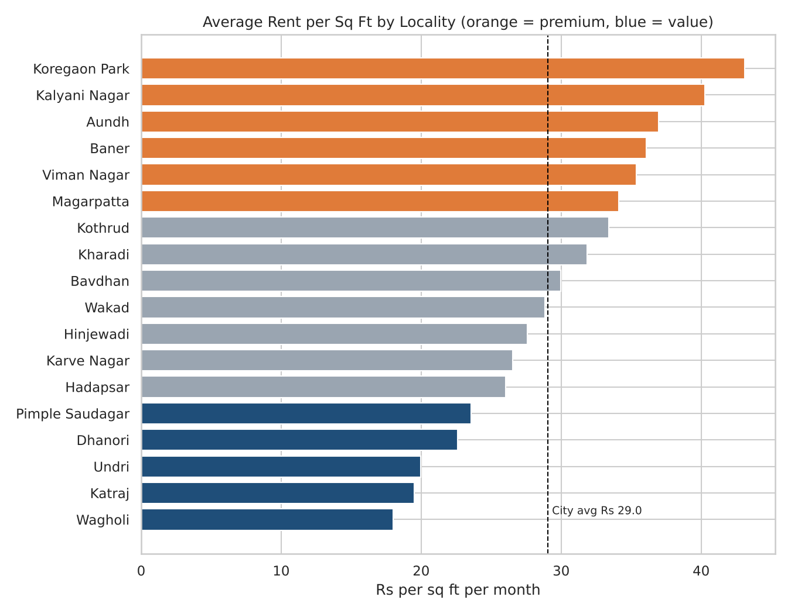
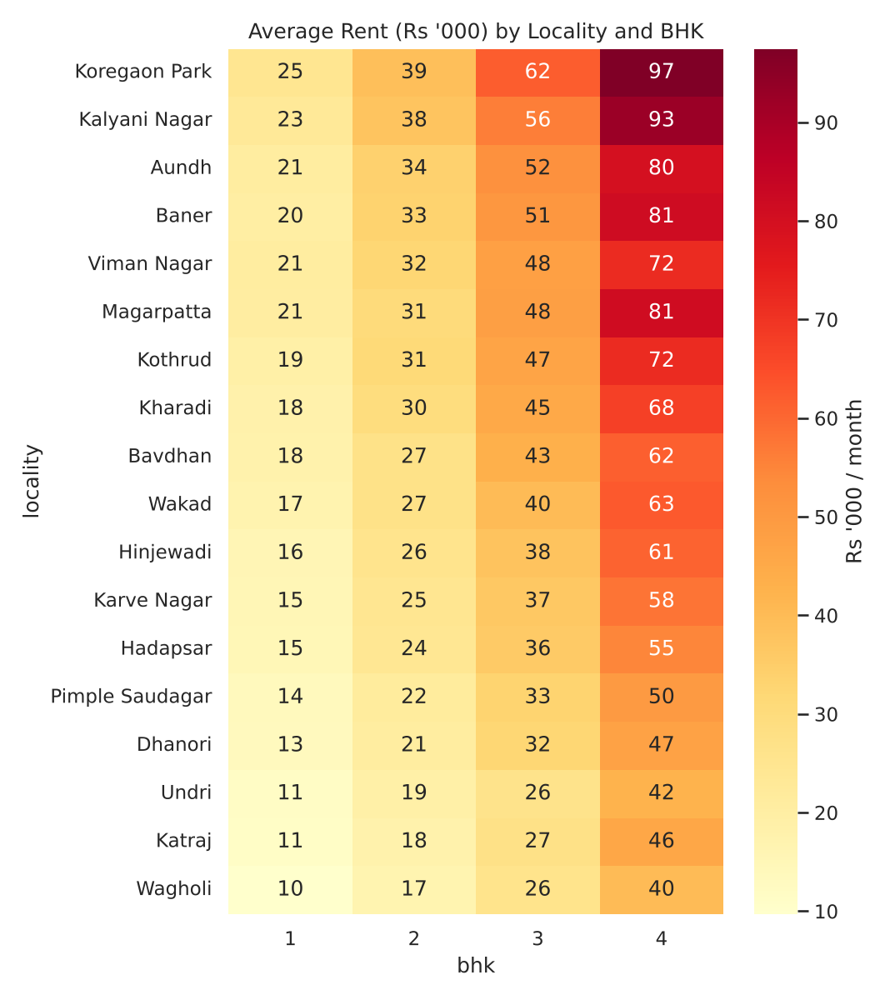

# Pune Rental Market Analysis

**End-to-end data analytics project: Python + MySQL + Power BI**

## Business Question
> Which Pune localities give the best value for a fresher or IT professional, and where are rents overheated?

Renters, relocating professionals and property managers have no simple, data-backed way to compare Pune localities on price per sq ft, furnishing premium, deposit norms and budget fit. This project turns raw, messy rental listings into a decision-ready analysis and dashboard.

## Dataset
- ~6,000 raw rental listings: locality, BHK, area, furnishing, rent, deposit, floor, property age, parking, property type, listing date.
- Raw data is messy on purpose (as real scraped data is): prices like `₹ 25,000`, areas like `850 sq.ft`, inconsistent locality casing, duplicates, missing values and impossible entries.

> **Data note (important):** the file `data/raw/pune_rental_raw.csv` in this repository is a **simulated sample** produced by `scripts/generate_sample_data.py` so the whole pipeline can be run and tested. Replace it with real listings (see "Using real data" below) before treating any finding as a market fact.

## Tech Stack
Python (Pandas, NumPy, Matplotlib, Seaborn) | MySQL 8 (CTEs, window functions) | Power BI (DAX) | Jupyter Notebook | Git

## Project Structure
```
pune-rental-market-analysis/
├── data/
│   ├── raw/pune_rental_raw.csv            # messy input
│   └── processed/pune_rental_clean.csv    # analysis-ready output
├── scripts/
│   ├── generate_sample_data.py            # builds the simulated sample
│   ├── clean_data.py                      # Pandas cleaning pipeline
│   └── eda_charts.py                      # charts + insight summary
├── sql/
│   ├── 01_schema_and_load.sql             # MySQL table + load steps
│   └── 02_analysis_queries.sql            # 15 business questions
├── notebooks/01_pune_rental_analysis.ipynb
├── powerbi/DASHBOARD_GUIDE.md             # pages, DAX measures, design rules
├── images/                                # charts (and dashboard screenshots)
├── docs/                                  # cleaning log, insights summary
└── requirements.txt
```

## How to Run
```bash
pip install -r requirements.txt
python scripts/clean_data.py       # raw -> clean CSV + docs/cleaning_log.txt
python scripts/eda_charts.py       # charts in images/ + docs/insights_summary.md
```
Then load `data/processed/pune_rental_clean.csv` into MySQL with `sql/01_schema_and_load.sql`, run `sql/02_analysis_queries.sql`, and build the dashboard with `powerbi/DASHBOARD_GUIDE.md`.

## Methodology
1. **Cleaning (Pandas):** standardised locality text, converted currency/area strings to numbers, removed duplicate listings, filled missing values with documented rules (locality medians, "Unknown" furnishing), removed impossible rows and outliers using the IQR rule per BHK.
2. **Feature engineering:** rent per sq ft, rent band, deposit in months of rent, listing month, zone.
3. **SQL analysis:** 15 queries covering KPIs, locality ranking (`RANK`), furnishing premium (CTE), month-on-month trend (`LAG`), price tiers (`NTILE`), best-value listings per locality (`ROW_NUMBER`) and overpriced-listing flags (subquery).
4. **Visualisation:** 7 charts in Python and a 4-page Power BI dashboard with DAX measures.

## SQL Highlights
| Question | Technique |
|---|---|
| Rank localities by rent per sq ft | `RANK() OVER` |
| Furnishing premium vs unfurnished | CTE + join |
| Month-on-month rent change | `LAG()` |
| Split localities into 4 price tiers | `NTILE(4)` |
| Top 3 value listings per locality | `ROW_NUMBER() PARTITION BY` |
| Overpriced listings vs locality norm | Subquery + join |

## Charts



## Findings and Recommendations
See `docs/insights_summary.md` (auto-generated from the current data). Write your final 4-5 findings here **after running on real data**, for example:
1. Premium vs value localities and the size of the gap.
2. Furnishing premium (% extra per sq ft).
3. Best-value areas for a fresher budget.
4. Seasonality or trend in rent.
5. A clear recommendation for renters or property managers.

## Using Real Data
Option A: download a Pune / India house-rent dataset from Kaggle and filter for Pune.
Option B: collect listings manually or from a site whose terms allow it, for 300+ listings.

Save it as `data/raw/pune_rental_raw.csv` with these column names (map yours to them):

| Column | Meaning |
|---|---|
| listing_id | unique id |
| locality | area name |
| bhk | 1, 2, 3, 4 |
| area_sqft | size |
| furnishing | Unfurnished / Semi-Furnished / Furnished |
| rent_inr | monthly rent |
| deposit_inr | security deposit |
| floor, property_age_years, bathrooms | numeric |
| parking | Yes / No |
| property_type | Apartment / Independent House / Builder Floor |
| listing_date | YYYY-MM-DD |

If a column does not exist in your data, drop its steps in `clean_data.py`. If your locality list differs, update the `ZONES` dictionary in `clean_data.py`. Then re-run the pipeline.

## Author
Sidharth Kamble | github.com/sidharth-kamble | linkedin.com/in/sidharthkamble467885
